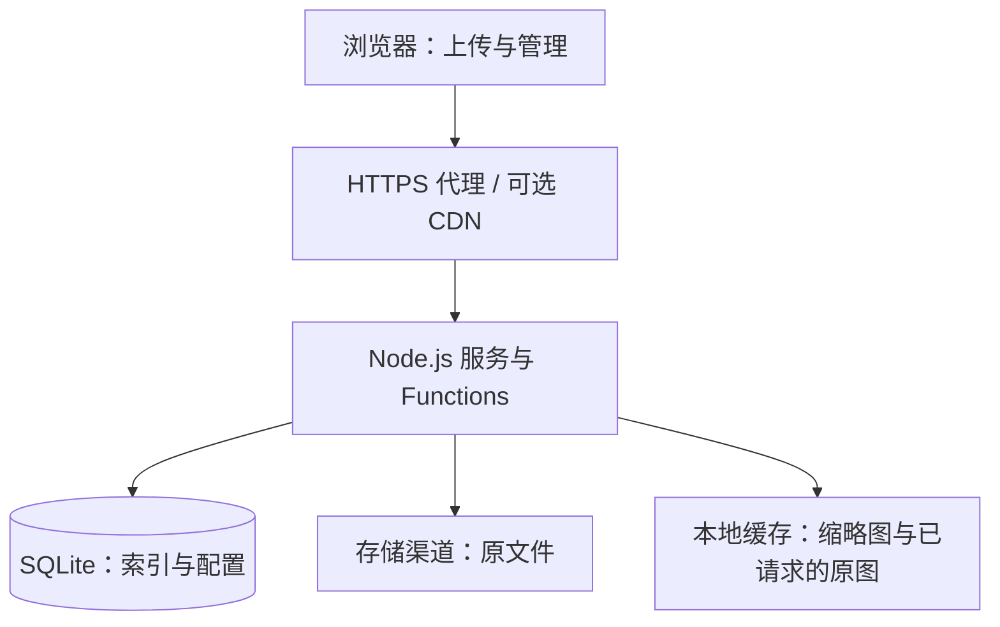
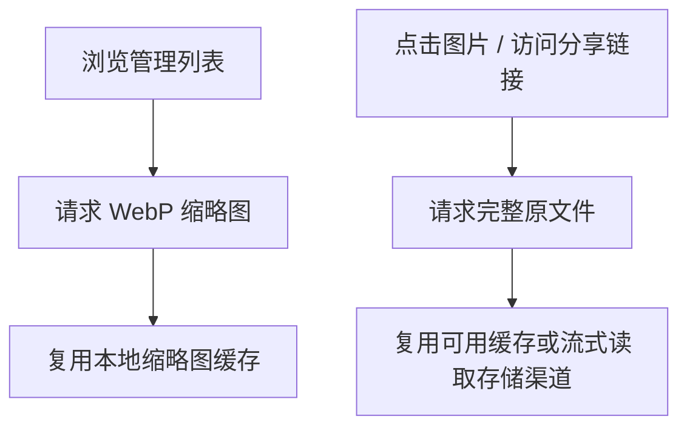
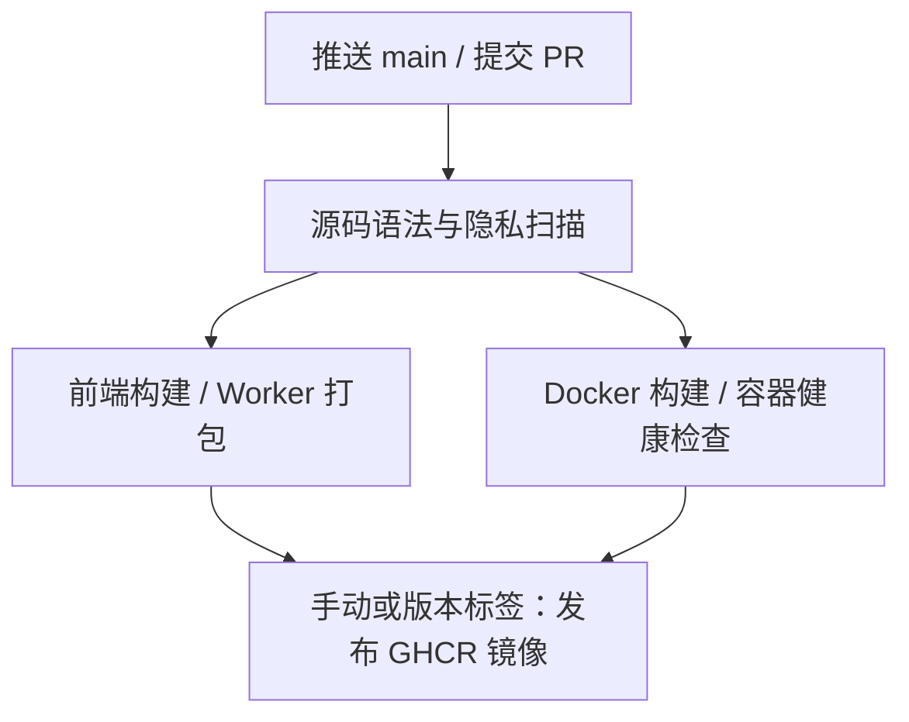

# Wenying ImgBed

[](https://github.com/ayingQAQ/Wenying-imgbed/actions/workflows/ci.yml)
[](LICENSE)

一个前后端一体的自建图床与文件管理项目，基于 [CloudFlare-ImgBed](https://github.com/MarSeventh/CloudFlare-ImgBed) 和 [Sanyue-ImgHub](https://github.com/MarSeventh/Sanyue-ImgHub) 开发。Vue 3 管理界面与 Node.js 服务一起构建，可通过 Docker 在 VPS 上运行，也保留可选的 Workers 适配层。

## 功能

| 模块 | 能力 |
| --- | --- |
| 上传 | 拖拽、粘贴、批量与分片上传、上传目录选择 |
| 文件管理 | 连续滚动、重命名、移动、删除、标签、多选及目录导航 |
| 图片浏览 | 视野附近预载缩略图；点击后查看原图 |
| 分享 | 原始链接、Markdown、HTML、BBCode；公开链接隐藏目录路径 |
| 存储 | R2、Hugging Face、Telegram、Discord、S3 兼容存储、WebDAV 等 |
| 管理 | 管理员认证、上传来源统计、当前文件数量及原文件逻辑容量 |
| 页面 | 深浅主题、响应式布局、动态启动加载与失败重试 |

Telegram 可以作为独立上传渠道；是否另作备份由配置决定。容量统计表示当前索引中原文件的逻辑大小，不等于 VPS 磁盘占用，也不包含缩略图及额外备份。

## 系统结构

图按职责拆分、从上到下排列，避免把全部细节挤进一张小字大图。



- **前端**：Vue 3、Vue Router、Vuex、Element Plus；源码在 `frontend/`。
- **后端**：Hono / Node.js，复用 `functions/` 请求处理逻辑，SQLite 适配 D1 接口。
- **持久化**：`/app/data` 保存数据库、本地存储及缓存，应挂载到宿主机并独立备份。
- **存储**：原文件保存在所选渠道；Docker 可通过 S3 API 直接访问 R2，无需额外 Worker 网关。
- **Workers**：可选部署方式，使用 D1/R2 绑定；CI 只检查打包，不部署真实资源。

## 缩略图与原图



管理列表不使用原图充当缩略图。VPS 缩略图缓存默认预算为 2 GiB；原图缓存只保留已请求的小文件，默认预算 512 MiB、单文件上限 16 MiB、有效期 24 小时。不会为了列表预览下载整本相册的原图。

分享链接和 Markdown 指向原文件。CDN 复用缓存，不会自动缩小原图，几十 MB 的图片首次访问仍需要相应带宽。删除会执行渠道清理并使相关缓存失效，但渠道权限、平台删除限制、外部 CDN 和浏览器已有缓存仍可能影响最终可见时间。

## Docker 部署

建议使用 Linux 和 Docker Compose。Docker 从源码构建前后端，不需要提交本机编译产物。

```bash
git clone https://github.com/ayingQAQ/Wenying-imgbed.git
cd Wenying-imgbed
cp .env.example .env
# 编辑 .env，设置 BASIC_USER、BASIC_PASS 和 PUBLIC_HOSTS
docker compose up -d --build
```

首次运行必须设置管理员账号和强密码。服务默认只监听宿主机 `127.0.0.1:7658`，通过自己的 HTTPS 代理对外提供访问。先在管理界面配置上传渠道、访客权限和上传限制，再开放服务。`PUBLIC_HOSTS` 为可信域名列表，多个域名用逗号分隔。

本地存储默认位于数据卷内。原生 R2 需要补齐 `.env` 中的 `R2_S3_ENDPOINT`、`R2_S3_BUCKET`、`R2_ACCESS_KEY_ID`、`R2_SECRET_ACCESS_KEY`。其他渠道通过管理界面配置，凭证保存在私有数据库中。

**已有部署升级**：保留自己的 `.env` 和 `data/`，先备份数据库与配置，再重建容器。不要用空目录替换现有数据卷。公开仓库不包含个人备案、真实服务器配置、凭证、运行数据或本机测试资料。

## 本地开发

使用 Node.js 22 和 npm；前后端分别保留锁文件。

```bash
npm ci
npm --prefix frontend ci
npm run build:frontend
npm run check
node --env-file=.env --import ./deploy/server/register.mjs deploy/server/index.js
```

`npm run start:docker` 适用于已注入环境变量的进程，不会自动读取 `.env`。前端热更新可运行 `npm --prefix frontend run serve`，通过私有的 `frontend/.env.development.local` 设置 `VUE_APP_BACKEND_URL`。前端环境变量会进入浏览器资源，不能放服务端密钥。

## GitHub Actions



| 工作流 | 触发与产物 |
| --- | --- |
| Verify and build | main 推送、PR 或手动运行。扫描凭证与公开文件，校验语法，构建前端和 Worker，检查容器页面资源、统计接口和管理认证。前端产物保留 7 天。 |
| Publish container | 手动运行或推送 `v*` 标签；完整验证通过后发布 `linux/amd64` 镜像到 GHCR。使用 GitHub 自带令牌，无需 VPS 凭证。 |
| Dependabot | 每月检查 Actions 和 npm 依赖，创建更新 PR，不自动合并。 |

Actions 按任务授予最小权限，并固定到版本的提交 SHA。常规推送只验证，不修改线上服务器。镜像发布入口：**Actions → Publish container → Run workflow → main**。首次发布后，可在 Packages 设置镜像可见性。

镜像名为 `ghcr.io/ayingqaq/wenying-imgbed`。main 手动发布生成 `latest` 和 `sha-*`；版本发布生成对应标签和 `sha-*`。建议使用确定版本或摘要升级以便回滚。发布前会再次执行全部验证。

## 可选 Workers 部署

生成脚本从环境读取绑定，不把真实数据库 ID、域名或凭证写入源码。

```bash
# 在私有环境设置 D1_DATABASE_ID、R2_BUCKET_NAME，并完成 Wrangler 认证
npm run build:frontend
npm run deploy:worker
```

部署前按需设置 `WORKER_NAME`、`CUSTOM_DOMAIN`，完成 D1 建表及服务端 Secrets 配置。敏感业务配置使用 Wrangler Secrets，不放入 `WORKER_VARS` 或提交生成的 TOML。高级回退拓扑参见 `deploy/worker/dual-backend.example.json`；只有配好共享状态服务及独立 HTTPS 源站后再启用。

## 目录与许可

```text
frontend/          Vue 前端源码
functions/         共享业务接口与存储适配
deploy/server/     Node.js / SQLite / 本地缓存适配
deploy/worker/     可选 Workers 入口与配置生成
database/          建表与迁移
scripts/           发布校验与运行健康检查
.github/           CI、镜像发布与依赖更新
```

原作者版权与 MIT 许可保留在 [LICENSE](LICENSE) 和 [frontend/LICENSE](frontend/LICENSE)。整理提交历史不会改变代码归属与许可义务。
